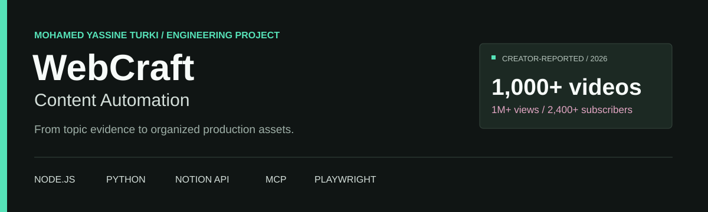
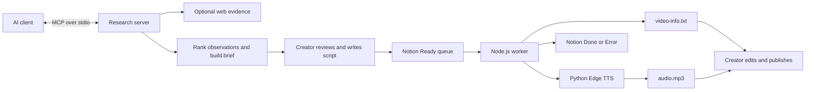

<p align="center"></p>

<p align="center">
  <a href="https://www.youtube.com/@WebCraft25">YouTube channel</a> &nbsp; / &nbsp;
  <a href="docs/case-study.md">Engineering case study</a> &nbsp; / &nbsp;
  <a href="docs/setup.md">Setup guide</a> &nbsp; / &nbsp;
  <a href="docs/mcp.md">MCP server</a>
</p>

# WebCraft Content Automation

**A creator's production workflow turned into a software engineering project.**

Built by [Mohamed Yassine Turki](https://github.com/MohamedYassineTurki), ICT engineer at INSAT and creator of [WebCraft](https://www.youtube.com/@WebCraft25). The project connects topic research, an editorial handoff, a Notion queue, and voiceover production. Its earlier pipeline also explored API-generated scripts and automated browser recording.

| 2026 production milestone | WebCraft channel reach | WebCraft audience |
| :--- | :--- | :--- |
| **1,000+ videos produced with workflow support** | **1,000,000+ views** | **2,400+ subscribers** |

These are creator-reported milestones as of November 2026. Views and subscribers describe the channel, not a measured causal effect of automation. The channel is public supporting evidence; the exact historical totals and workflow usage are not independently audited. [Evidence and attribution](docs/impact.md).

## See it work in one minute

Requires Node.js 22+. The demo uses the actual queue engine with synthetic Notion rows and a simulated speech adapter. It needs no API keys, network calls, or accounts.

```sh
git clone https://github.com/MohamedYassineTurki/webcraft-content-automation.git
cd webcraft-content-automation
npm ci
npm run demo
```

```text
WEBCRAFT / OFFLINE DEMO
Synthetic rows and simulated speech. No credentials, APIs, real audio, or Notion writes.

Queue: 2 row(s), oldest first.
Job 1/2: How to Upscale an Image: A Practical Walkthrough
[1/5] Creating job folder
[2/5] Updating status to Generating
[3/5] Writing video-info.txt
[4/5] Generating voiceover
[5/5] Updating status to Done
...
Finished: 2 done, 0 failed, 0 remaining.
```

`npm run demo:failure` demonstrates a failed first job leaving the next row `Ready`. Demo output is deliberately named `audio.demo.txt`; live production writes a real `audio.mp3`. [Full demonstration transcript](docs/demo-output.txt).

## What is implemented

| Component | Implementation | Status |
| --- | --- | --- |
| Production queue | Notion API, sequential execution, job folders, completion metadata | Runnable; based on the existing workflow |
| Voiceover | Node.js supervises Python Edge TTS; configurable voice, rate, pitch, volume | Live service; subject to availability and throttling |
| Research MCP server | Three schema-validated tools over stdio using the official MCP SDK | New portfolio implementation, November 2026 |
| Research evidence | Optional Brave web search; deterministic ranking of supplied video observations | Search needs its own key; ranking/briefs work locally |
| Editorial control | Final script prepared/reviewed in ChatGPT, pasted into Notion | Human step |
| Earlier experiments | Website extraction, Gemini/OpenAI scripting, Gemini speech, Playwright recording | Historical modules under `legacy/` |
| Final edit and publication | Creator reviews audio, records/edits footage, and publishes | Human step |

The new MCP server does not claim to implement vidIQ's MCP integration. Earlier research used existing connected tools. [Using MCP versus implementing MCP](docs/mcp.md#what-changed).

## Architecture



The research-to-Notion handoff is manual. The MCP server does not silently create rows or publish videos. [Architecture and failure boundaries](docs/architecture.md).

## Engineering decisions

- **Stop on the first failed job.** A provider outage should not consume the entire queue. Completed rows stay `Done`; later rows stay `Ready`.
- **Make the ordering explicit.** Notion rows are queried by `created_time` ascending, including pagination. This is oldest-first, not arbitrary UI drag order.
- **Keep editorial judgment.** The current worker uses approved scripts rather than silently generating factual reviews.
- **Contain unreliable dependencies.** Speech runs in a subprocess with a shared timeout, bounded retries, partial-file cleanup, and visible progress. HTTP 429 currently stops the run instead of hammering the provider.
- **Make review reproducible.** The queue, MCP protocol, and retry behavior have offline tests and CI; the live service is not required to run them.

## Run the live workflow

See [the setup guide](docs/setup.md) for the Notion schema and Python installation. After configuration:

```sh
npm start
npm run titles
npm run mcp
```

Each successful row creates:

```text
outputs/jobs/<timestamp>-<title>-<id>/
  audio.mp3
  video-info.txt
```

Windows users can double-click `run-worker.cmd` or `print-done-titles.cmd`; both keep the terminal open. Use `node src/cli.js --page PAGE_ID` to explicitly rerun one row, regardless of its current status.

## Verify

```sh
npm run check
npm test
npm run audit:source
```

After Python setup, run `.venv\Scripts\python.exe tests/test-edge-tts-retries.py` on Windows or `.venv/bin/python tests/test-edge-tts-retries.py` on Linux/macOS. GitHub Actions runs both test suites on Linux and Windows. [Testing scope](docs/architecture.md#verification).

## Repository map

```text
src/            Production worker, Notion adapter, research tools, MCP server
tests/          Queue, protocol, research, and speech recovery tests
examples/       Fictional sample rows for a credential-free demo
legacy/         Earlier API scripting and browser recording modules
docs/           Case study, architecture, impact, MCP, setup, demo transcript
scripts/        Setup, syntax checking, publication hygiene checks
```

## Limitations

Edge TTS is an unofficial client for Microsoft's online Read Aloud service. Availability, accepted headers, and rate limits can change. No unlimited-service or commercial-usage entitlement is implied. There is no automatic YouTube upload, no persistent distributed queue, and no exactly-once guarantee after a machine crash. Local locking only prevents simultaneous runs sharing one output directory. Legacy provider modules are retained for study and are not covered by the current live integration tests.

MIT-licensed original project code; third-party dependencies keep their own licenses. [Contributing](CONTRIBUTING.md) · [Security](SECURITY.md) · [Changelog](CHANGELOG.md)
