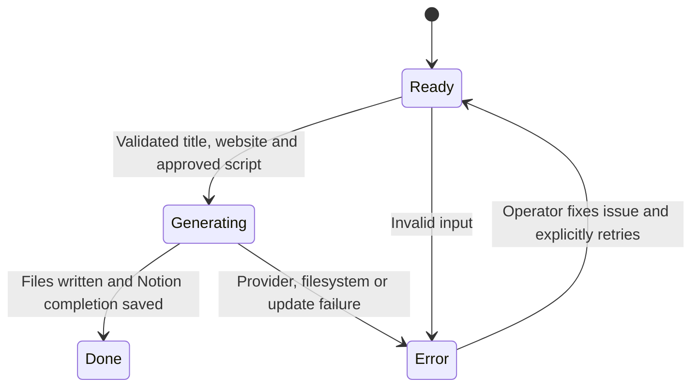

# Architecture and operational boundaries

## Research interface

`src/mcp-server.js` is a stdio MCP server built using the official TypeScript SDK's JavaScript interfaces and Zod schemas. It exposes optional public web search, a deterministic ranking heuristic, and a content-brief builder. Tool outputs retain source URLs. A brief is handed to the creator for script preparation; it is not automatically inserted into Notion.

## Production engine

`src/cli.js` creates the API client, takes a local filesystem lock, fetches rows, and injects the Notion and speech adapters into `src/worker.js`. This separation lets the same queue engine run under offline tests and the demo.

The row status is an operator-visible progress marker. It is not a transactional distributed lock. The CLI's `.run.lock` prevents overlapping workers only when they share the same output root. Running separate machines or output roots against one database requires external coordination.

## Failure behavior

| Failure | Behavior |
| --- | --- |
| Empty script | Mark row Error; stop before TTS |
| One failed job | Keep earlier Done rows; stop; leave later rows Ready |
| HTTP 403 during speech | Up to three total audio attempts; alternate endpoint on the first qualifying rejection |
| Connection failure | Up to three total attempts; 20-second wait between attempts |
| HTTP 429 | Surface throttling and stop; no key/IP rotation or immediate retry loop |
| Overall TTS timeout | Kill subprocess; delete incomplete MP3; surface error |
| Notion error-write failure | Print explicit warning; operator must inspect the row |
| Machine interruption | Lock/Generating row can require manual recovery; resumability is not implemented |

Clock correction uses the HTTPS service's Date header only inside token generation. Third-party package source and Windows time settings are not edited. Compatibility adjustments remain dependent on Microsoft's service behavior.

## Ordering and persistence

The queue uses Notion API version `2022-06-28`, with rows ordered by creation time ascending. This matches oldest-first processing, not arbitrary visual order in a manually sorted Notion view. Equal timestamps do not have a documented secondary ordering guarantee. Limits are applied across paginated responses. Completed unposted title export uses the same ordering contract.

Production writes `audio.mp3` and `video-info.txt` into timestamped directories. Filenames are sanitized and include an ID fragment. There is no automatic cleanup of user production outputs and no automatic YouTube upload.

## Verification

- Node tests cover successful asset creation, stop-on-failure boundaries, empty scripts, pagination, title filtering, research calculations, invalid inputs, provider-error handling, and real MCP client/server discovery and calls.
- Python tests cover connection retry boundaries, configuration errors, service rejection, endpoint headers, and server-clock correction.
- CI runs on Linux and Windows without contacting Notion, Microsoft speech, Brave, or YouTube. It runs the offline demo as a reproducibility check.
- Live Edge TTS generation requires network access and is separate from deterministic CI. Legacy model and recording modules have syntax checks, but their live provider behavior is not certified by this test suite.

The publication source check catches common credential patterns and private paths in tracked source. It is a useful guard, not a guarantee that no secret could ever be committed.
